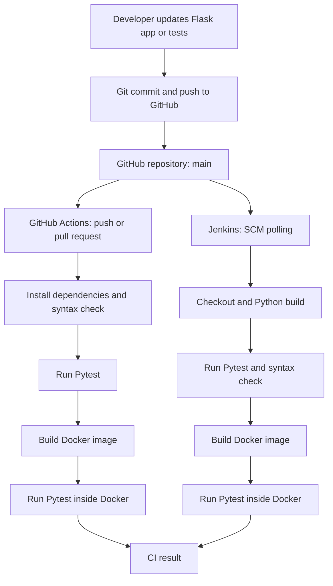

# ACEest Fitness & Gym — Automated CI/CD Pipeline Implementation

[](https://github.com/2025tm93095-shekar-jk/aceest-fitness-gym/actions/workflows/build.yml)

> **BITS | Introduction to DevOps — Assignment 1**  
> **Assignment title:** Implementing Automated CI/CD Pipelines for ACEest Fitness & Gym  
> **Repository:** [2025tm93095-shekar-jk/aceest-fitness-gym](https://github.com/2025tm93095-shekar-jk/aceest-fitness-gym)  
> **Main branch:** `main`

## 1. Project Overview

**ACEest Fitness & Gym** is a lightweight fitness-management web application built with **Python, Flask, and SQLite**, with a responsive **HTML/CSS/JavaScript dashboard**. It provides fitness program information, client registration, workout logging, weekly progress recording, and membership expiry tracking.

The primary purpose of this repository is to demonstrate a practical **DevOps software delivery lifecycle**: version-controlled development, automated testing, repeatable Docker builds, and continuous integration with **Jenkins** and **GitHub Actions**.

**Project outcome:** A functional Flask application with **22 Pytest test cases**, a containerized runtime, and two independent build-and-test pipelines.

> **Scope clarification:** The implemented Jenkins and GitHub Actions workflows automate **continuous integration, build validation, and testing**. They do **not** deploy the application to a production environment. Despite the assignment's CI/CD terminology, production continuous deployment is outside the current implementation.

---

## 2. Original Assignment Details

### 2.1 Assignment Objective

The assignment is intended to provide hands-on experience in modern DevOps practices, particularly:

- **Version control:** Git and GitHub for source tracking and collaboration.
- **Application testing:** Pytest for automated validation of core features.
- **Containerization:** Docker for reproducible application environments.
- **Continuous integration:** Jenkins and GitHub Actions for repeatable build and test processes.

### 2.2 Problem Statement

**Scenario:** As a **Junior DevOps Engineer** at ACEest Fitness & Gym, a growing startup, design an automated workflow that protects code integrity, provides consistent execution environments, and supports faster, more reliable delivery.

The application must move through a controlled lifecycle, beginning with local development and progressing to an automated **Jenkins BUILD environment**, with additional automated verification through **GitHub Actions**.

### 2.3 Six Core Assignment Phases

| Phase | Original requirement | Implementation in this repository |
|---|---|---|
| **1. Application Development & Modularization** | Build a foundational Flask application using the supplied Python logic as a starting point. | Flask REST endpoints, SQLite persistence, and a simple browser dashboard. |
| **2. Version Control Strategy** | Initialize Git, synchronize with a public GitHub repository, and use meaningful commits. | Public GitHub repository on `main` with incremental commits. |
| **3. Unit Testing & Validation** | Write Pytest cases to verify application behavior before build. | `tests/test_app.py` contains **22 tests**, including successful and invalid-request scenarios. |
| **4. Docker Containerization** | Package the application, dependencies, and environment into a portable Docker image. | `Dockerfile` uses `python:3.9-slim`, installs dependencies, and includes backend, frontend, and tests. |
| **5. Jenkins BUILD & Quality Gate** | Configure Jenkins to check out GitHub source and run a clean build and quality validation. | `Jenkinsfile` performs checkout, dependency installation, Pytest, Python syntax inspection, Docker build, and Docker-based tests. |
| **6. GitHub Actions Pipeline** | Trigger a workflow on pushes and pull requests; run build/syntax checks, assemble the Docker image, and test inside Docker. | `.github/workflows/build.yml` runs all required validation steps on GitHub-hosted Ubuntu runners. |

**Workflow filename note:** The assignment brief suggests `.github/workflows/main.yml`. This implementation uses **`.github/workflows/build.yml`**, which is a valid GitHub Actions workflow location and performs the required steps.

### 2.4 Required Submission Deliverables

The original brief requests a **public GitHub repository** containing:

1. **Application source:** `app.py` and `requirements.txt`.
2. **Automated tests:** Pytest scripts.
3. **Infrastructure and automation:** A working `Dockerfile` and GitHub Actions YAML workflow.
4. **Documentation:** A professional `README.md` explaining local execution, manual tests, and Jenkins/GitHub Actions integration.

This repository also includes the **`Jenkinsfile`**, frontend assets, and supporting evidence folders.

### 2.5 Evaluation Criteria

The assignment evaluates **application integrity**, **Git/VCS maturity**, **test coverage**, **Docker efficiency and security**, **Jenkins and GitHub Actions reliability**, and **documentation quality**. This README explains the implementation against those criteria; the CI logs and screenshots should be used as execution evidence.

---

## 3. Implemented Application Features

| Feature | Description |
|---|---|
| Fitness programs | View **Fat Loss**, **Muscle Gain**, and **Beginner** programs with example workout and diet guidance. |
| Client registration | Register a client with name, age, weight, and selected program; save the record in SQLite. |
| Program-based calorie calculation | Calculate an illustrative calorie value using the selected program's factor multiplied by body weight. |
| Workout logging | Save workout date, type, duration, and optional notes for an existing client. |
| Weekly progress | Record a client's week and adherence percentage (0–100). |
| Membership tracking | Set and retrieve a client's membership expiry date; return `Active`, `Expired`, or `Not Set` status. |
| Web dashboard | Use browser forms to call the Flask API and show the resulting JSON responses. |

**Dashboard limitation:** The dashboard submits records and displays responses; it does **not** yet provide searchable client lists, workout-history tables, or analytics charts. Those features are not required for this assignment demonstration.

**Calorie-calculation note:** The formula is a simple application example, not an individualized medical or nutrition recommendation.

### Technology Stack

| Layer | Technology |
|---|---|
| Programming language | Python 3.9 in the automated build environments |
| API/backend | Flask 3.0.3 |
| Database | SQLite (`sqlite3`, Python standard library) |
| Frontend | HTML, CSS, JavaScript (Fetch API) |
| Automated tests | Pytest 8.3.2 and Flask test client |
| Version control | Git and GitHub |
| Containerization | Docker, `python:3.9-slim` |
| CI platforms | Jenkins and GitHub Actions |

---

## 4. Repository Structure

```text
aceest-fitness-gym/
├── .github/
│   └── workflows/
│       └── build.yml          # GitHub Actions CI workflow
├── screenshots/              # Assignment evidence/screenshots
├── static/
│   └── style.css             # Dashboard styling
├── templates/
│   └── index.html            # Dashboard HTML and frontend JS
├── terminal_commands/        # Command/evidence resources
├── tests/
│   └── test_app.py           # Automated Flask/Pytest tests
├── .dockerignore             # Files excluded from Docker build context
├── .gitignore                # Files excluded from Git tracking
├── Dockerfile                # Application container image definition
├── Jenkinsfile               # Jenkins Pipeline as Code
├── README.md                 # Project and assignment documentation
├── app.py                    # Flask routes, application logic, SQLite setup
└── requirements.txt          # Flask and Pytest dependencies
```

For practical examples and artifacts, see the [`screenshots/`](screenshots/) and [`terminal_commands/`](terminal_commands/) directories.

---

## 5. Run the Application Locally

### Prerequisites

- Git
- Python **3.9** (the version used in Docker/GitHub Actions), with `venv` and `pip`
- A modern web browser
- Docker, **only** for the containerized steps

### Clone and install dependencies (Linux)

```bash
git clone https://github.com/2025tm93095-shekar-jk/aceest-fitness-gym.git
cd aceest-fitness-gym

python3 -m venv venv
source venv/bin/activate
python -m pip install --upgrade pip
python -m pip install -r requirements.txt
```

### Start the Flask application

```bash
python app.py
```

By default, the app runs on **port 5000**. Open the following URLs:

| URL | Purpose |
|---|---|
| http://localhost:5000/dashboard | Fitness management dashboard |
| http://localhost:5000/ | JSON welcome endpoint |
| http://localhost:5000/programs | All fitness programs as JSON |
| http://localhost:5000/programs/fat_loss | One program as JSON |

The app initializes its SQLite database when started with `python app.py`. By default, the database file is **`aceest_fitness.db`** in the current working directory. To choose another location, set the `ACEEST_DB` environment variable before launching.

Stop the app with `Ctrl+C`.

> **Development note:** Flask's built-in server is sufficient for this educational project, but it is not intended as a production deployment server.

---

## 6. REST API Reference

The JSON API is implemented in [`app.py`](app.py). The dashboard uses these same endpoints.

| HTTP method | Endpoint | Function | Typical success status |
|---|---|---|---|
| `GET` | `/` | Welcome message | `200` |
| `GET` | `/programs` | List programs | `200` |
| `GET` | `/programs/<program_id>` | Get one program | `200` |
| `POST` | `/clients` | Create a client | `201` |
| `POST` | `/workouts` | Log a workout for an existing client | `201` |
| `POST` | `/clients/<name>/progress` | Save weekly adherence | `201` |
| `PUT` | `/clients/<name>/membership` | Update membership expiry | `200` |
| `GET` | `/clients/<name>/membership` | Read membership expiry and status | `200` |
| `GET` | `/dashboard` | Render browser dashboard | `200` |

### Example API requests

Run the application first, then use a separate terminal:

**List all programs**

```bash
curl http://localhost:5000/programs
```

**Register a client**

```bash
curl -X POST http://localhost:5000/clients \
  -H "Content-Type: application/json" \
  -d '{"name":"Demo Client","age":25,"weight":80,"program":"fat_loss"}'
```

The `fat_loss` factor is **22**, so the example returns an illustrative value of **1,760 calories** (`80 × 22`). Valid program keys are `fat_loss`, `muscle_gain`, and `beginner`.

**Log a workout**

```bash
curl -X POST http://localhost:5000/workouts \
  -H "Content-Type: application/json" \
  -d '{"client_name":"Demo Client","date":"2026-10-11","workout_type":"Strength Training","duration_min":45,"notes":"Back and biceps"}'
```

**Save weekly progress**

```bash
curl -X POST http://localhost:5000/clients/Demo%20Client/progress \
  -H "Content-Type: application/json" \
  -d '{"week":"2026-W41","adherence":85}'
```

**Update membership expiry**

```bash
curl -X PUT http://localhost:5000/clients/Demo%20Client/membership \
  -H "Content-Type: application/json" \
  -d '{"membership_expiry":"2027-12-31"}'
```

**Read membership status**

```bash
curl http://localhost:5000/clients/Demo%20Client/membership
```

Common validation responses include `400` for invalid inputs, `404` for unknown clients/programs, and `409` for duplicate client names. Registration is required before logging a workout or progress for a client.

---

## 7. Automated Testing with Pytest

The test suite lives in [`tests/test_app.py`](tests/test_app.py) and contains **22 test functions** covering:

- Home endpoint and dashboard HTML rendering
- Retrieving valid and invalid fitness programs
- Client creation, validation, and duplicate detection
- Weekly progress, adherence bounds, and unknown clients
- Workout creation, date/duration validation, and unknown clients
- Membership updates, active/expired status, invalid dates, and missing clients

Tests use Flask's test client and a **separate temporary SQLite database per test**, preventing tests from altering the application's normal database.

### Run the full test suite

```bash
python -m pytest -v
```

**Expected when all tests pass:** `22 passed`.

### Check Python syntax

```bash
python -m compileall -q app.py tests
```

This checks whether the Python files **compile successfully**. It is a syntax validation step, **not** a full linter or static-analysis security audit.

---

## 8. Docker Containerization

The [`Dockerfile`](Dockerfile) uses the `python:3.9-slim` base image and:

1. Sets `/app` as the working directory.
2. Installs Python dependencies from `requirements.txt`.
3. Copies Flask source, Pytest tests, HTML templates, and CSS files.
4. Exposes port **5000**.
5. Starts the Flask application using `python app.py`.

### Build the Docker image

```bash
docker build -t aceest-fitness-gym:latest .
```

### Execute tests inside Docker

```bash
docker run --rm aceest-fitness-gym:latest python -m pytest -v
```

**Expected when all tests pass:** `22 passed`.

### Run the Docker container

```bash
docker run --rm -p 5000:5000 aceest-fitness-gym:latest
```

Open http://localhost:5000/dashboard.

### Optional: persist SQLite data across container restarts

```bash
docker run --rm -p 5000:5000 \
  -e ACEEST_DB=/data/aceest_fitness.db \
  -v aceest-data:/data \
  aceest-fitness-gym:latest
```

The named Docker volume `aceest-data` retains the database across container removal and recreation. Without a volume, data written only inside a disposable container will be lost when that container is removed.

> **Security note:** The Docker configuration is sufficient for coursework demonstration but has not been presented as production-hardened (for example, it does not specify a dedicated non-root runtime user).

---

## 9. Jenkins — BUILD and Quality Gate

The repository contains a declarative [`Jenkinsfile`](Jenkinsfile). The Jenkins job is configured as **Pipeline script from SCM**, pointing to this GitHub repository on the `main` branch, with `Jenkinsfile` as the script path.

### Jenkins pipeline stages

| Stage | Jenkins action |
|---|---|
| **Checkout** | Get the latest code using `checkout scm`. |
| **Build** | Create `.venv` and install dependencies from `requirements.txt`. |
| **Test** | Execute the complete Pytest suite. |
| **Code Inspection** | Compile Python files using `compileall -q`. |
| **Docker Build** | Build the `aceest-fitness-gym:latest` image. |
| **Docker Test** | Run Pytest inside the built image. |

**SCM polling trigger:** `H/2 * * * *` — Jenkins checks Git for changes on an approximately two-minute polling schedule. This is **polling**, not a GitHub webhook.

**Requirements on the Jenkins agent:** Python 3 with `venv`, Git, Docker CLI/daemon, and permission for the Jenkins service account to access Docker. Jenkins reports success only when the required pipeline stages complete successfully.

**Quality-gate scope:** Pytest results and Python syntax compilation are the implemented checks. The project does not configure SonarQube or a separate full linting tool.

---

## 10. GitHub Actions — Automated CI Pipeline

**Workflow file:** [`.github/workflows/build.yml`](.github/workflows/build.yml)  
**Workflow name:** `ACEest Fitness CI/CD`  
**Runner:** `ubuntu-latest`  
**Python version:** `3.9`  
**Triggers:** Every `push` to `main` and every `pull_request` targeting `main`.

### Workflow execution steps

1. **Checkout Source Code** — `actions/checkout@v4`.
2. **Set Up Python** — `actions/setup-python@v5` with Python 3.9.
3. **Install Dependencies** — install packages from `requirements.txt`.
4. **Check Python Syntax** — `python -m compileall -q app.py tests`.
5. **Run Pytest** — `python -m pytest -v`.
6. **Build Docker Image** — `docker build -t aceest-fitness-gym:latest .`.
7. **Run Tests Inside Docker** — `docker run --rm aceest-fitness-gym:latest python -m pytest -v`.

Review execution history in [**GitHub Actions**](https://github.com/2025tm93095-shekar-jk/aceest-fitness-gym/actions/workflows/build.yml). A green workflow status indicates that all required steps passed for that specific commit.

### CI pipeline architecture



The two systems validate the **same application independently**. A failed command causes the relevant job or build to fail, making problems visible before further delivery.

---

## 11. Assignment Verification Checklist

| Assessment item | Evidence in this repository |
|---|---|
| Flask application and business logic | [`app.py`](app.py) |
| Local setup and dependencies | [`requirements.txt`](requirements.txt) and Section 5 |
| Source control with Git/GitHub | [Public repository and commit history](https://github.com/2025tm93095-shekar-jk/aceest-fitness-gym/commits/main/) |
| Automated Pytest suite | [`tests/test_app.py`](tests/test_app.py) — 22 test cases |
| Docker packaging | [`Dockerfile`](Dockerfile) and [`.dockerignore`](.dockerignore) |
| Jenkins BUILD pipeline | [`Jenkinsfile`](Jenkinsfile) |
| GitHub Actions build/test automation | [`.github/workflows/build.yml`](.github/workflows/build.yml) |
| Web dashboard | [`templates/index.html`](templates/index.html) and [`static/style.css`](static/style.css) |
| Submission evidence | [`screenshots/`](screenshots/) and [`terminal_commands/`](terminal_commands/) |
| Project documentation | This `README.md` |

### Suggested evidence to include for evaluation

Screenshots or command outputs can demonstrate: local dashboard functionality, the `22 passed` Pytest output, successful Docker build/tests, the completed Jenkins stage view/console output, and a successful GitHub Actions workflow run. Save evidence in the existing folders and ensure screenshots do not reveal credentials or sensitive data.

---

## 12. Key Learnings and Conclusion

This assignment demonstrates how a small Flask application can be developed and verified through a repeatable DevOps workflow:

- **Git/GitHub** preserve application and infrastructure changes in version control.
- **Pytest** catches regressions in API and application behavior.
- **Docker** provides a consistent packaged environment for running the app and tests.
- **Jenkins** supplies a dedicated, repeatable BUILD and validation pipeline.
- **GitHub Actions** automatically validates relevant repository updates.
- **README documentation and evidence** make the solution understandable and reproducible for reviewers.

**Final deliverable:** A publicly accessible, containerized Flask fitness-management project with working CI automation in Jenkins and GitHub Actions, submitted through the repository link below.

**Repository:** https://github.com/2025tm93095-shekar-jk/aceest-fitness-gym
